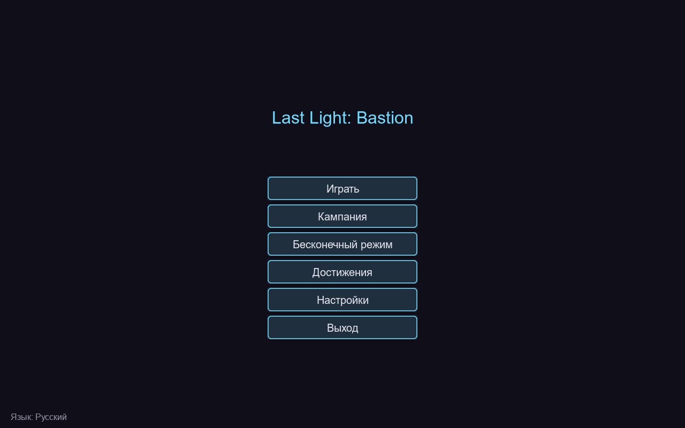
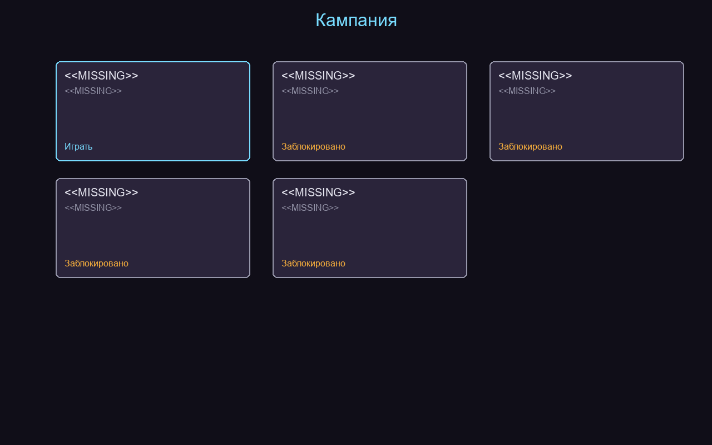
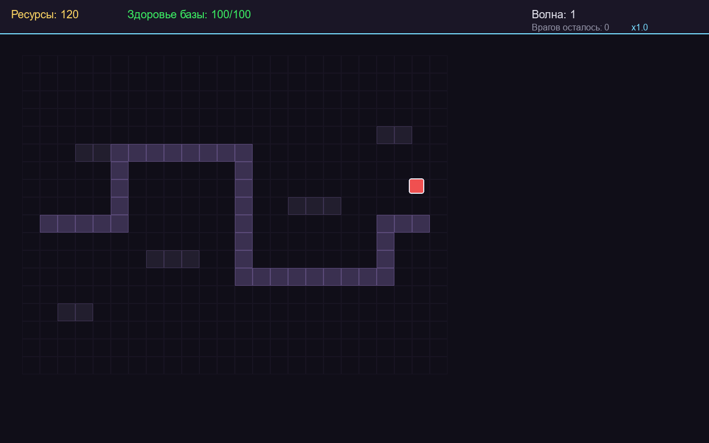

# Last Light: Bastion

**Last Light: Bastion** is a complete 2D tower defense game written in Python 3.11+ using the `pygame-ce` library. It is a standalone, independently playable game suitable for an open professional portfolio on GitHub.

## Game concept

The last human settlement is protected by an ancient energy barrier called the Bastion. Hostile creatures emerge from corrupted lands and attempt to destroy its core. The player must build and upgrade towers, manage limited resources, exploit enemy weaknesses, and survive increasingly difficult waves.

Core loop:

> Choose Map → Prepare Defense → Build Towers → Start Wave → Earn Resources → Upgrade Strategy → Defeat Boss → Complete Mission.

## Features

* **Five unique maps** with distinct layouts, entries, exits, obstacles, and build zones. One advanced map features two simultaneous routes.
* **Six tower types** (Archer, Cannon, Frost, Arc, Poison, Support), each with 3 upgrade levels, unique range, attack speed, damage, projectile, and tactical role.
* **Seven enemy archetypes** (Basic, Fast, Armored, Heavy, Flying, Regenerating, Elite) differing in speed, health, armor, resistance, reward, and behavior.
* **Three unique bosses** with special abilities, attack warnings, and required counterplay.
* **25 campaign waves**, data-driven wave composition, intermissions, preparation phases, elite and boss waves, followed by an endless survival mode.
* **Economy**: starting currency, kill rewards, tower and upgrade costs, selling with partial refunds, base health, defeat conditions.
* **Strategy**: target priorities (first, last, strongest, weakest, closest), tower synergy, enemy resistances/weaknesses, range visualization, placement validation, pause, adjustable game speed.
* **Campaign**: five maps, unlockable stages, mission objectives, star rating system, 10+ achievements, best results, endless mode.
* **Localization**: Russian by default, full English support, language change without restart, centralized translations.
* **Saves**: versioned, atomic writes, recovery from corrupted save files.
* **Tests**: 93 automated pytest tests covering maps, pathfinding, towers, enemies, projectiles, waves, bosses, economy, saves, localization.

## Screenshots (from the actual application)

Main menu:



Campaign selection:



Gameplay:



English language:


## Controls

| Key / mouse | Action |
|---|---|
| Left click on map | Build selected tower or select an existing tower |
| Left click on menu button | Navigate menus |
| `1`–`5` | Game speed (0.5× … 3×) |
| `Space` | Start wave |
| `Esc` / `P` | Pause / resume |

In play mode, the top HUD shows resources, base health, wave, remaining enemies, and speed. Selecting a tower opens an upgrade/sell panel.

## Towers

| Tower | Description |
|---|---|
| Archer | Inexpensive, fast single-target fire |
| Cannon | Slow, powerful area damage |
| Frost | Slows enemies in its area |
| Arc | Damage chains between targets |
| Poison | Damage over time |
| Support | Boosts nearby towers |

Each tower has 3 upgrade levels with real gameplay effects.

## Enemies

Basic, Fast, Armored, Heavy, Flying, Regenerating, Elite. Flying enemies move over terrain and can only be targeted by ranged towers.

## Bosses

Void Reaver, Flame Titan, Storm Colossus — appear at key campaign waves, with large health pools, distinct abilities, and visual attack warnings.

## Campaign and progression

Five maps unlock in order. Each mission awards up to three stars based on remaining base health. Progress, achievements, stars, and best scores persist between launches. Endless survival mode with escalating difficulty is available.

## Architecture

The code is split into modules:

* `main.py` — application lifecycle and game loop
* `state.py` — game state and simulation (rendering-independent)
* `map.py` — maps, routes, validation, pathfinding, placement checks
* `tower.py` — towers, targeting, upgrades, projectile emission
* `enemy.py` — enemies, movement, status effects
* `projectile.py` — projectiles, collision, chain damage, splash
* `boss.py` — bosses and abilities
* `wave.py` — waves, spawning, intermissions, endless mode
* `campaign.py` — campaign, achievements, progression
* `save.py` / `settings.py` — versioned saving and settings
* `i18n.py` — centralized localization
* `renderer.py` — rendering
* `ui.py` — UI control
* `graphics.py` / `resources.py` — procedural graphics, no external assets

## Installation and launch

Python 3.11+ is required.

```bash
# Clone or copy the repository
cd "Last Light Bastion"

# Create a virtual environment
python -m venv .venv
.venv\Scripts\Activate.ps1   # Windows

# Install dependencies
pip install -r requirements.txt

# Run the game
python src\last_light_bastion\main.py
```

Or install the package and use the entry point:

```bash
pip install -e .
last-light-bastion
```

## Development

```bash
# Install development tools
pip install -e ".[dev]"

# Run tests
pytest

# Linter and formatter
ruff check src tests
ruff format --check src tests
```

## Testing

The project contains 93 pytest tests. Run them with:

```bash
pytest
```

Tests cover map validation, pathfinding, enemy movement, tower placement and upgrades, target selection, projectile collision, damage and armor, status effects, economy, wave generation, bosses, saves, and localization.

## Known limitations

* Audio is optional; the game runs safely when no audio device is available.
* Graphics are procedurally generated pixel art; no external assets are required.
* Saves are stored locally in the `saves/` directory.

## License

MIT. Copyright (c) 2026 devilnevecry. See the `LICENSE` file.
