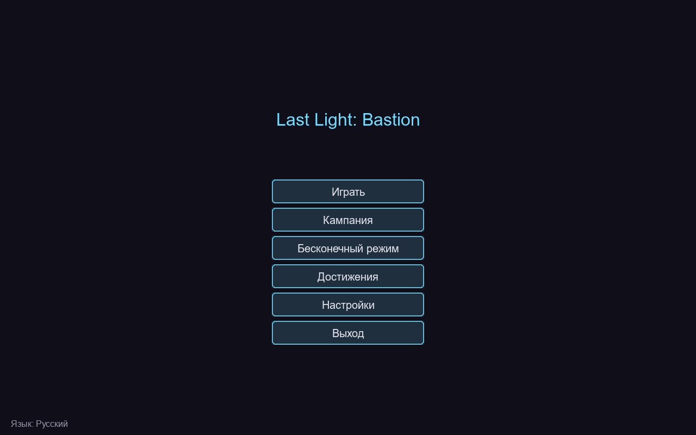
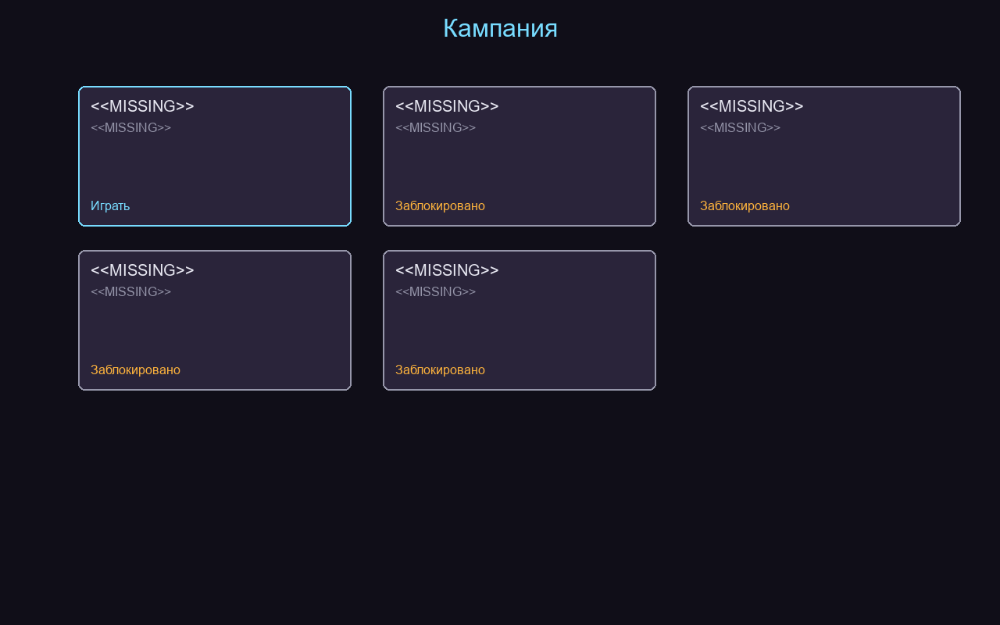
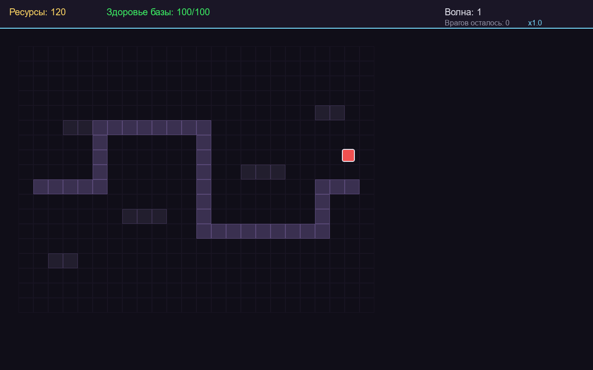

# Last Light: Bastion

**Last Light: Bastion** — полноценная 2D башенная защита (tower defense), написанная на Python 3.11+ с использованием библиотеки `pygame-ce`. Игра предназначена для независимого запуска и подходит для открытого профессионального портфолио на GitHub.

## Концепция игры

Последнее поселение людей защищено древним энергетическим барьером — Бастионом. Враждебные создания из пороченных земель стремятся уничтожить его сердце. Игрок должен строить и улучшать башни, управлять ограниченными ресурсами, эксплуатировать слабости врагов и выдерживать всё более сложные волны.

Базовый цикл игры:

> Выбор карты → Подготовка обороны → Постройка башен → Начало волны → Заработок ресурсов → Улучшение стратегии → Победа над боссом → Завершение миссии.

## Особенности

* **Пять уникальных карт** с разной географией, входами, выходами, препятствиями и зонами постройки. Одна карта имеет два одновременных маршрута.
* **Шесть типов башен** (лучница, пушка, ледяная, разрядная, ядовитая, оплот), каждая с 3 уровнями улучшения, собственной дальностью, скоростью атаки, уроном, снарядом и тактическим назначением.
* **Семь типов врагов** (обычный, быстрый, бронированный, тяжёлый, летающий, регенерирующий, элитный) с различиями в скорости, здоровье, броне, сопротивлении и награде.
* **Три уникальных босса** с особыми способностями, предупреждениями об атаке и необходимым контрастированием.
* **25 сценариев волн** kampanii, данные волны управляются данными (JSON-подобная конфигурация), есть прерывы между волнами, этапы подготовки, волны с элитой и боссами, а затем бесконечный режим.
* **Экономика**: начальные ресурсы, награды за уничтожение, стоимость башен и улучшений, продажа с частичным возвратом, здоровье базы, условия поражения.
* **Стратегия**: приоритеты цели (первый, последний, сильнейший, слабейший, ближайший), синергия башен, сопротивления и слабости врагов, визуализация радиуса, валидация постройки, пауза, регулируемая скорость игры.
* **Кампания**: пять карт, разблокируемые этапы, цели миссий, система звёзд, достижения (10+), лучшие результаты, бесконечный выживальный режим.
* **Локализация**: русский язык по умолчанию, полная поддержка английского, смена языка без перезапуска, централизованные переводы.
* **Сохранения**: версионированные, атомарные записи, восстановление после повреждённых файлов.
* **Тесты**: 93 автоматизированных теста pytest (карты, поиск пути, башни, враги, снаряды, волны, боссы, экономика, сохранения, локализация).

## Скриншоты (из реального приложения)

Главное меню:



Выбор кампании:



Игровой процесс:



Английский язык:


## Управление

| Клавиша / мышь | Действие |
|---|---|
| ЛКМ по карте | Построить выбранную башню или выбрать существующую |
| ЛКМ по кнопке меню | Навигация по меню |
| `1`–`5` | Скорость игры (0.5× … 3×) |
| `Пробел` | Начать волну |
| `Esc` / `P` | Пауза / продолжить |

В игровом режиме верхняя панель отображает ресурсы, здоровье базы, волну,remaining врагов и скорость игры. При выборе башни появляется панель улучшения/продажи.

## Башни

| Башня | Описание |
|---|---|
| Лучницкая | Дешёвая, быстрая, однокачественная стрельба |
| Пушечная | Медленная, мощный урон по области |
| Ледяная | Замедляет врагов в зоне поражения |
| Разрядная | Урон перепрыгивает между целями |
| Ядовитая | Урон со временем (DOT) |
| Оплот | Усиливает соседние башни |

Каждая башня имеет 3 уровня улучшения с реальным игровым эффектом.

## Враги

Обычный, быстрый, бронированный, тяжёлый, летающий, регенерирующий, элитный. Летающие враги Moving над рельефом и доступны только для дальней стрельбы.

## Боссы

Пожиратель пустоты, Пламенный титан, Колосс шторма — появляются на ключевых волнах кампании, имеют большой запас здоровья, особые способности и визуальные предупреждения.

## Кампания и прогрессия

Пять карт открываются по порядку. За каждую миссию выдаются до трёх звёзд в зависимости от оставшегося здоровья базы. Прогресс, достижения, звёзды и лучшие результаты сохраняются между запусками. Доступен бесконечный режим с нарастающей сложностью.

## Архитектура

Код разделён на модули:

* `main.py` — жизненный цикл приложения и игровой цикл
* `state.py` — игровое состояние и симуляция (независимая от отрисовки)
* `map.py` — карты, маршруты, валидация, поиск пути, проверка постройки
* `tower.py` — башни, прицеливание, улучшения, emisión снарядов
* `enemy.py` — враги, движение,	status-эффекты
* `projectile.py` — снаряды, столкновения, цепной урон, брызги
* `boss.py` — боссы и их способности
* `wave.py` — волны, спавн, перерывы, бесконечный режим
* `campaign.py` — кампания, достижения, прогрессия
* `save.py` / `settings.py` — версионированное сохранение и настройки
* `i18n.py` — централизованная локализация
* `renderer.py` — отрисовка
* `ui.py` — управление интерфейсом
* `graphics.py` / `resources.py` — процедурная графика без внешних ассетов

## Установка и запуск

Требуется Python 3.11+.

```bash
# Клонируйте репозиторий (или скопируйте файлы)
cd Last Light Bastion

# Создайте виртуальное окружение
python -m venv .venv
.venv\Scripts\Activate.ps1   # Windows

# Установите зависимости
pip install -r requirements.txt

# Запустите игру
python src\last_light_bastion\main.py
```

Или установите пакет и запустите через точку входа:

```bash
pip install -e .
last-light-bastion
```

## Разработка

```bash
# Установка инструментов разработки
pip install -e ".[dev]"

# Запуск тестов
pytest

# Линтер и форматтер
ruff check src tests
ruff format --check src tests
```

## Тестирование

Проект содержит 93 теста pytest. Запуск:

```bash
pytest
```

Тесты покрывают валидацию карт, поиск пути, движение врагов, постройку и улучшение башен, выбор цели, столкновения снарядов, урон и броню, статус-эффекты, экономику, генерацию волн, боссов, сохранения и локализацию.

## Известные ограничения

* Звук не является обязательным компонентом; игра корректно работает при недоступном аудиоустройстве.
* Графика генерируется процедурно (пиксель-арт стиль), внешние ассеты не требуются.
* Сохранения хранятся локально в каталоге `saves/`.

## Лицензия

MIT. Copyright (c) 2026 devilnevecry. См. файл `LICENSE`.
